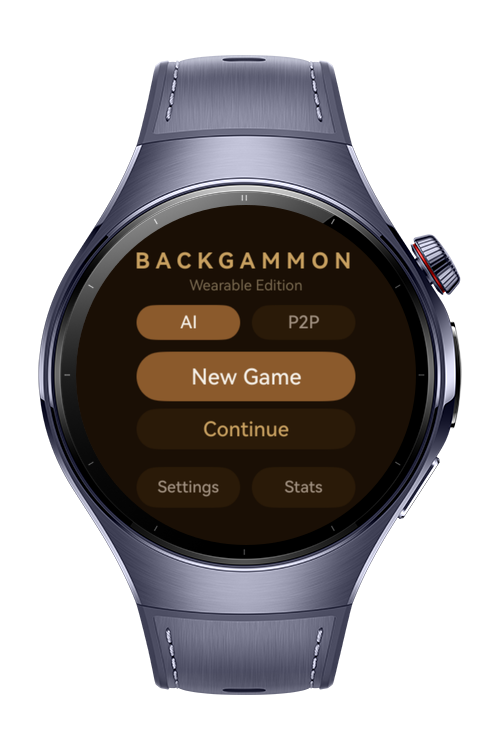
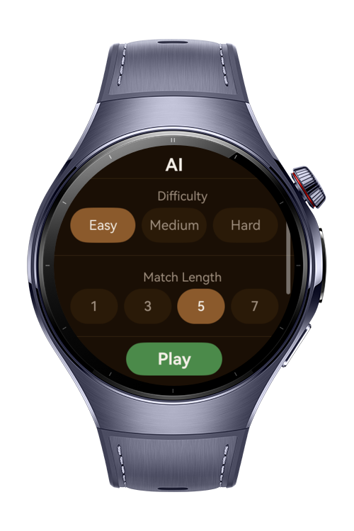
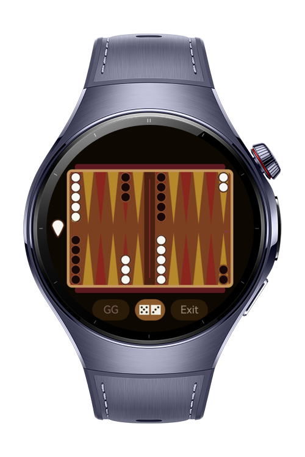

> **Note:** To access all shared projects, get information about environment setup, and view other guides, please visit [Explore-In-HMOS-Wearable Index](https://github.com/Explore-In-HMOS-Wearable/hmos-index).

# Backgammon Wearable
Backgammon Wearable is a fully-featured Backgammon game built for HarmonyOS smartwatches. Play against an AI opponent or pass the device between two players, complete with match scoring, a doubling cube, haptic feedback, and multiple board themes.

# Preview

<div>
  
  
  
</div>

# Use Cases

- **VS AI**: Play against an AI opponent at Easy, Medium, or Hard difficulty
- **Local Two-Player**: Pass-the-device multiplayer two players share one watch
- **Match Play**: First-to-N-points format with doubling cube support
- **Statistics**: Track lifetime wins, losses, and win streaks across sessions
- **Tutorial**: Built-in interactive guide to learn the rules of Backgammon

# Tech Stack

Languages: ArkTS, ArkUI
Frameworks: HarmonyOS SDK 6.0.0
Tools: DevEco Studio
Libraries/Kits:

- `@kit.ArkUI` — declarative UI, Canvas 2D rendering, NavPathStack navigation
- `@kit.ArkData` — Preferences API for persistent settings and game state
- `@kit.PerformanceAnalysisKit` — `hilog` structured logging
- `@ohos.vibrator` — haptic feedback patterns per game event
- `@ohos/hypium` — unit and integration test framework
- `@ohos/hamock` — mock library for testing

# Directory Structure

```
entry/src/main/ets/
├── pages/
│   ├── Index.ets             # Home screen — new game / continue / settings
│   ├── GamePage.ets          # Main game — state machine, dice, moves, undo, AI
│   ├── GameSetupPage.ets     # Pre-game config (mode, AI level, theme…)
│   ├── SettingsPage.ets      # Persistent app settings
│   ├── WinPage.ets           # Game-over screen with result and match score
│   ├── StatsPage.ets         # Lifetime win/loss/streak statistics
│   └── TutorialPage.ets      # Interactive rules tutorial
├── components/
│   ├── BoardCanvas.ets       # Full board via Canvas 2D (checkers, points, bar, animation)
│   ├── DiceComponent.ets     # Animated dice roll widget
│   └── DiceFace.ets          # Single die face renderer
├── engine/
│   ├── MoveEngine.ets        # Pure game rules — validation, bear-off, pip count
│   └── AIEngine.ets          # AI move selection (Easy / Medium / Hard)
├── model/
│   └── GameTypes.ets         # Shared types: Player, GamePhase, Move, GameStateCore
└── utils/
    ├── SoundHapticManager.ets  # Vibration patterns for each game event
    └── StatsManager.ets        # Load / save / update lifetime stats
```

# Constraints and Restrictions

## Supported Devices

- Huawei Watch 5

# License

Backgammon Wearable is distributed under the terms of the MIT License. See the [LICENSE](LICENSE) for more information.
